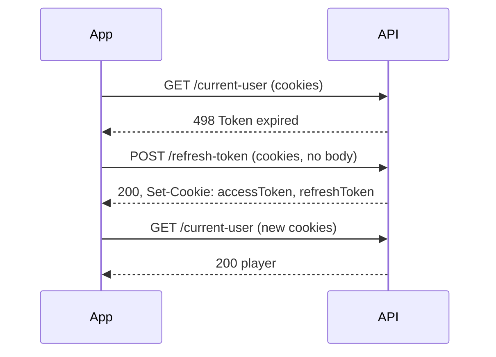

# Authentication

How players sign in, how the session is kept, and how the app knows who is calling. Read this before adding a call that needs a signed-in player, or a feature that only players can use.

Known gaps and their fixes are in `impl/auth-challenges.md`.

## In short

- A player signs in with an **email code (OTP)** or **Google**. There is no password.
- The backend keeps the session in two **httpOnly cookies**: `accessToken` and `refreshToken`. JavaScript can't read them, so the app never sees or stores a token.
- The app only tracks **whether** the player is signed in: `signedIn` is `null` (not known yet), `true` or `false`. It learns this from the API's answers.
- On page load, `GET /current-user` tells the app if the cookies hold a session, and returns the player.
- When the access token expires, the API answers **498**. The app calls `/refresh-token` once, and retries the call.
- Every API call goes through one of two functions:
  - `unauthenticatedFetch` never sends cookies;
  - `authenticatedFetch` always sends them.

## Files

| File | What it does |
| --- | --- |
| `src/core/api/client.ts` | The two fetchers, the `signedIn` state, the refresh on 498 |
| `src/core/api/auth.ts` | The auth calls: `sendOtp`, `loginSignupUser`, `googleSignIn`, `getCurrentUser`, `logout` |
| `src/core/api/endpoints.ts` | Every endpoint path |
| `src/core/models/auth.model.ts` | zod schemas for the auth responses and `AuthUser` |
| `src/features/auth/index.ts` | The public hooks: `useAuthSession`, `useRequireAuth`, `useAuthGate`, `useCurrentUser` |
| `src/features/auth/data/authData.ts` | The user store, `useEmailOtpLogin`, `useGoogleLogin`, `useLogout`, the device id |
| `src/features/auth/screens/AuthScreen.tsx` | The `/auth` screen |
| `src/features/auth/components/auth-panel.tsx` | The form: email, code, Google button. UI only |
| `src/features/auth/components/auth-gate-host.tsx` | Renders the login prompt; mounted once in `src/app/layout.tsx` |
| `src/features/auth/components/authGateDialog.tsx` | The login prompt ("LOG IN TO …") |
| `src/features/auth/components/logout-button.tsx` | LOG OUT, shown only to a signed-in player |

`core/api/index.ts` exports `getSignedIn` and `subscribeSession`, but not `setSignedIn` or the fetchers. Screens can't reach the backend, or change the session, except through the calls in `auth.ts` and `public-api.ts`.

## The backend's side

These are the backend's rules. The app depends on them.

| Endpoint | Fetcher | Body | What the API does |
| --- | --- | --- | --- |
| `POST /api/v1/authorization/send-otp` | `unauthenticatedFetch` | `{ email, purpose: "otp" }` | Mails a 6-digit code |
| `POST /api/v1/authorization/loginSignupUser` | `authenticatedFetch` | `{ email, otp, deviceId, platform: "web" }` | Signs in, or creates the account; sets both cookies |
| `POST /api/v1/authorization/firebase/google` | `authenticatedFetch` | `{ idToken, deviceId, platform: "web" }` | Same, with a Firebase ID token |
| `GET /api/v1/user/current-user` | `authenticatedFetch` | – | The player, or 401 / 498 |
| `POST /api/v1/authorization/refresh-token` | `authenticatedFetch` | none | Reads the refresh cookie, sets both cookies again |
| `POST /api/v1/authorization/logout` | `authenticatedFetch` | none | Ends this device's session, clears both cookies |

The cookies:

- `httpOnly` and `Secure`;
- no `SameSite`, so browsers treat them as `Lax`. They're only sent when the app and the API share a site, which means both on `statoz.in`;
- no `maxAge`, so they're session cookies. Closing the browser signs the player out.

CORS on the API must answer the app's exact origin with `Access-Control-Allow-Credentials: true`, never `*`. A credentialed request against `*` fails in the browser as "Failed to fetch".

Status codes the app acts on:

| Code | Meaning | What the app does |
| --- | --- | --- |
| 401 | No session, or the API no longer accepts it | `setSignedIn(false)`: the player is a guest |
| 498 | Access token expired | Refresh once, retry the call once |
| 429 | Rate limit (60 requests per minute per IP) | Shows "Too many attempts…" |

The login responses also carry `accessToken` and `refreshToken` in the body. Those are for the mobile app. The web app ignores them and relies on the cookies.

## The session state

`client.ts` holds one value:

```ts
let signedIn: boolean | null = null;
```

| Value | Meaning | `AuthStatus` from `useAuthSession()` |
| --- | --- | --- |
| `null` | The API hasn't answered yet | `"hydrating"` |
| `true` | The API accepted the cookies | `"authenticated"` |
| `false` | No session | `"guest"` |

Only these set it:

| Who | Sets | When |
| --- | --- | --- |
| `signIn()` in `auth.ts` | `true` | A login succeeded |
| `getCurrentUser()` | `true` | It succeeded and `signedIn` was still `null` |
| `authenticatedFetch` | `false` | Any call ended in 401 |
| `logout()` | `false` | Always, even when the server can't be reached |

`subscribeSession(listener)` runs the listener on every change. React reads the state with `useSyncExternalStore(subscribeSession, getSignedIn, () => null)`.

The server snapshot is always `null` (`"hydrating"`). The Next.js server can't see the API's cookies, which belong to the API's domain, so the server-rendered HTML never knows if the player is signed in.

## The two fetchers

Both live in `client.ts`, take a path and a zod schema, and return the API's response (`ApiResult`) as it came.

```ts
unauthenticatedFetch(path, schema, init) // credentials: "omit"
authenticatedFetch(path, schema, init)   // credentials: "include", refresh on 498
```

Use `unauthenticatedFetch` for public data and for `send-otp`. It also works against an API that answers `*` for CORS.

Use `authenticatedFetch` for:

- anything that needs to know who the player is;
- the calls whose response sets the cookies (the logins and refresh). A response only sets cookies when the request was sent with `credentials: "include"`.

`authenticatedFetch`, step by step:

1. Send the call with cookies.
2. If it answered 498, and it isn't the refresh call itself, run the refresh.
3. If the refresh succeeded, send the call again, once.
4. If the final answer is 401, `setSignedIn(false)`.
5. Return the final answer.

## Refreshing the access token

`refreshTokens()` calls `POST /refresh-token` through `authenticatedFetch`, with no body and a 10-second timeout.

| Refresh answer | Outcome | Effect |
| --- | --- | --- |
| 2xx | `refreshed` | The original call is retried |
| 401 | `signedOut` | `authenticatedFetch` has already set `signedIn` to `false`; no retry |
| Anything else, offline, or timeout | `temporaryFailure` | Stays signed in; the original 498 is returned |

The rules:

- **One refresh at a time.** When several calls get 498 together, they all wait on the same refresh request, then each retries once.
- **The refresh never refreshes itself.** A 498 from `/refresh-token` is returned as it is, so it can't loop.
- **One retry only.** A second 498 after a successful refresh is returned to the caller.



## Page load

The first component that calls `useAuthSession()` or `useCurrentUser()` asks the API. In practice that's the nav, which is on every page.

1. The server renders the page with `"hydrating"`. The PROFILE item is a button, not a link, so nothing can navigate before auth is known.
2. On the client, `useCurrentUser()`'s effect sees `getSignedIn() === null` and calls `fetchCurrentUser()`.
3. `getCurrentUser()` calls `/current-user` through `authenticatedFetch`, refreshing on 498 if needed.
4. Depending on the answer:
   - **200:** `signedIn` becomes `true`, and the player goes into the user store.
   - **401:** `signedIn` becomes `false`. The nav shows LOG IN with a lock.

Only one `/current-user` call goes out per page load:

- `fetchCurrentUser()` shares one in-flight request between every screen that asks;
- the effect reads `getSignedIn()` live, not the rendered value. A component that hydrates late renders with the server's `null`, and would otherwise ask again after the answer is in.

## The current user

`useCurrentUser()` returns the signed-in player (`AuthUser`), or `null` for a guest or until it loads.

The user lives in a Zustand store in `authData.ts`, filled from:

- the login response (`result.data.user`), right after an email or Google login, so no extra `/current-user` call is needed;
- `/current-user` on page load.

It's cleared whenever `signedIn` becomes `false` (logout, or any 401). A `/current-user` answer that arrives after a logout is dropped.

The store is in memory only; nothing goes in `localStorage`. Coins and XP are as of the last login or page load, and are not re-fetched after the player earns or spends them (challenge 13).

## Email code login

`/auth` renders `AuthScreen`, which wires `AuthPanel` to `useEmailOtpLogin()`.

1. The player enters an email. The panel checks it loosely (`something@domain.tld`).
2. `sendCode(email)` calls `sendOtp(email, "otp")`.
   - The email is trimmed and lower-cased first. The backend hashes the code with the exact email, so both calls must send the same string.
   - The purpose must be `"otp"`. The default, `"login"`, makes a code that `loginSignupUser` rejects.
3. Once the code is sent, the code field appears. RESEND CODE is locked for 45 seconds.
4. The player enters the 6 digits. `verifyCode(email, otp)` calls `loginSignupUser` with the same normalised email, the code as a string, the device id and `platform: "web"`. A second submit while one is in flight is dropped, because a code works only once.
5. On success:
   - the API has set the cookies;
   - `signIn()` sets `signedIn` to `true`;
   - the user goes into the store;
   - `router.replace(returnPath())` takes the player back.

   `replace` keeps Back from returning to the login screen.
6. On failure, the backend's message is mapped to the player's words in `MESSAGES` (`authData.ts`). Anything unknown shows "Something went wrong. Please try again."

`isNewUser` is `true` when the email had no account. Nothing reads it yet; there is no onboarding (challenge 14).

## Google login

`useGoogleLogin()`:

1. Loads Firebase on the first click, not with the page, using `import("firebase/app")` and `import("firebase/auth")`. The config is `FIREBASE_CONFIG` in `core/env.ts`, and must be the Firebase project the backend verifies against.
2. Opens the Google account picker with `signInWithPopup`. On phones it opens as a new tab, which is normal.
3. Gets the **Firebase** ID token (`user.getIdToken()`), not a Google one, and sends it to `/firebase/google` with the device id and `platform: "web"`.
4. If the backend says "Invalid or expired Firebase token", fetches a fresh token (`getIdToken(true)`) and tries once more.
5. On success, the same as the email login: cookies, `signedIn = true`, user store, `router.replace(returnPath())`.
6. On failure, shows the mapped message and signs out of Firebase, so no half-signed-in Firebase state is left.

Closing the picker (`auth/popup-closed-by-user`, `auth/cancelled-popup-request`) isn't treated as an error.

The Firebase session isn't used after login. The backend's cookies are the session.

## Logout

`LogoutButton` (on `/profile`) calls `useLogout().logOut()`:

1. `logout()` calls `POST /logout` through `authenticatedFetch`, with an 8-second timeout. An expired access token is refreshed first, so the server really ends the session.
2. `setSignedIn(false)` runs whatever the server answered, which clears the user store.
3. Signs out of Firebase, if it was loaded.
4. `router.replace("/auth")`.

If the server can't be reached, the page still shows the player as signed out. The cookies stay, though, so the next page load signs them in again.

## Device id

Each browser gets one random id (`crypto.randomUUID()`), kept in `localStorage` under `statoz.deviceId`. It's sent with every login, so logging in again reuses this device's session on the backend instead of adding a new one. When storage is blocked, the tab uses an in-memory id instead.

It survives logout on purpose.

## Asking guests to log in

Anything that needs an account calls `useRequireAuth()`:

```tsx
const requireAuth = useRequireAuth();

<Button
  onClick={() => {
    if (!requireAuth({ intent: "lock a pick" })) return;
    lockPick();
  }}
/>
```

`requireAuth(request)` depends on the session:

| Status | Returns | Also |
| --- | --- | --- |
| `authenticated` | `true` | – |
| `hydrating` | `false` | Nothing, so a tap in the first frames does nothing |
| `guest` | `false` | Opens the login prompt, unless one is already open |

The request:

| Field | Use |
| --- | --- |
| `intent` | Completes the title "LOG IN TO …", e.g. `"view your profile"` |
| `message` | The body text. A generic line when left out |
| `returnTo` | Where to land after login. Defaults to the current path |

There's one prompt for the whole app:

- `useAuthGate` (Zustand) holds the open request;
- `AuthGateHost`, mounted once in `src/app/layout.tsx`, renders `AuthGateDialog` while there is one;
- LOG IN closes the prompt and opens `/auth?returnTo=<path>`;
- NOT NOW, Escape, ✕ or a press beside the card closes it;
- the nav stays visible beside it, and moving to another page closes it.

The nav gates PROFILE and SHOP the same way. While the session isn't `authenticated`, both are buttons that call `requireAuth` instead of links. Only a known guest sees PROFILE turn into LOG IN with a lock.

### `returnTo`

After login the app goes to `?returnTo` only when it's a path on this site: it must start with `/`, and not with `//`. Anything else goes to `/`, so a crafted link can't send the player to another site.

### Pages are not protected by URL

The gate only stops taps inside the app. Typing `/profile` or `/shop` into the address bar opens the page. Today these pages show nothing private, and any data they load would come from `authenticatedFetch`, which the API answers with 401 for a guest. Protect the page itself before it shows player data (challenge 19).

## How to

**Call an endpoint that needs the player**

1. Add the path to `ENDPOINTS` in `core/api/endpoints.ts`.
2. Write the schema in `core/models`.
3. Call it with `authenticatedFetch` from a function in `core/api`. Don't call `fetch` or `setSignedIn` yourself. 498 and 401 are handled for you.

**Gate an action**

Call `useRequireAuth()` and stop when it returns `false`, as in the example above.

**Show something only to signed-in players**

```tsx
const { status } = useAuthSession();
if (status !== "authenticated") return null;
```

Handle `"hydrating"` on its own when guests should see something else. Otherwise a signed-in player sees the guest version flash before the API answers.

**Read the player's coins, XP or name**

`const user = useCurrentUser();` It's `null` until loaded. `userName` is missing until a new account finishes profile setup.

## Local development

On `localhost`, a login against `dev-api.statoz.in` doesn't last. `localhost` and `statoz.in` are different sites, and the `Lax` cookies aren't sent from one to the other. The login call itself succeeds, but the next `/current-user` answers 401.

To work on signed-in screens, use one of:

- the backend running locally, on `localhost`, with its CORS set to the app's origin;
- the app served from a `statoz.in` subdomain, with that origin allowed on `dev-api`.

Public screens work on `localhost` as usual: their calls send no cookies.

## Testing it

Auth can be checked in headless Chrome over the DevTools protocol, with `Fetch.requestPaused` answering the auth endpoints:

- `/current-user` → 200 for signed in, 401 for a guest, 498 for an expired token;
- `/refresh-token` → 200, or 401 when the refresh token is dead.

Mocked responses need `Access-Control-Allow-Origin: http://localhost:3000` and `Access-Control-Allow-Credentials: true`, or the browser rejects them.

What to expect:

| Step | API calls | Result |
| --- | --- | --- |
| Guest opens a page | `current-user` (401) | LOG IN in the nav |
| Email login | `send-otp`, `loginSignupUser` | Back on `returnTo`, signed in |
| Reload while signed in | `current-user` | Signed in |
| Reload with an expired token | `current-user` (498) → `refresh-token` → `current-user` | Still signed in |
| Reload with a dead refresh token | `current-user` (498) → `refresh-token` (401) | Guest |
| Log out | `logout` | On `/auth`, guest |

Don't loop real calls against `dev-api` while testing: the limit is 60 requests per minute per IP.
