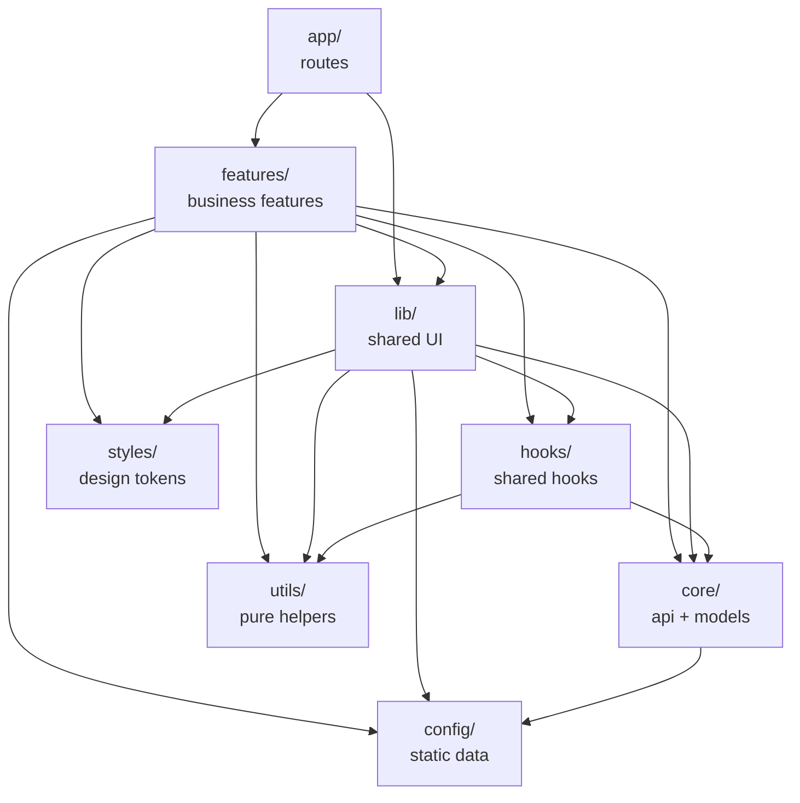
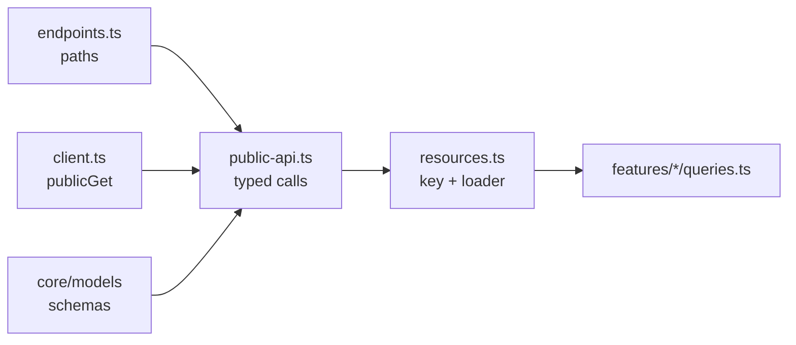
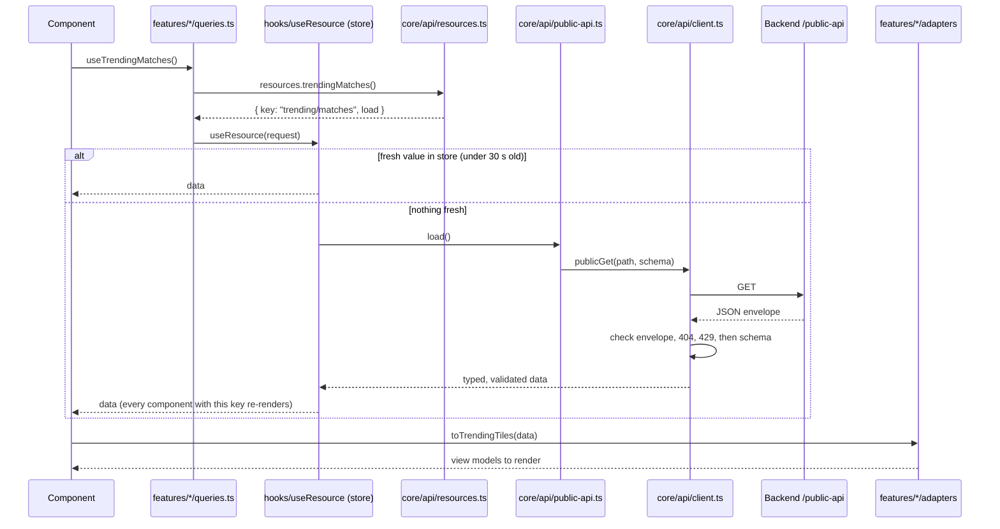
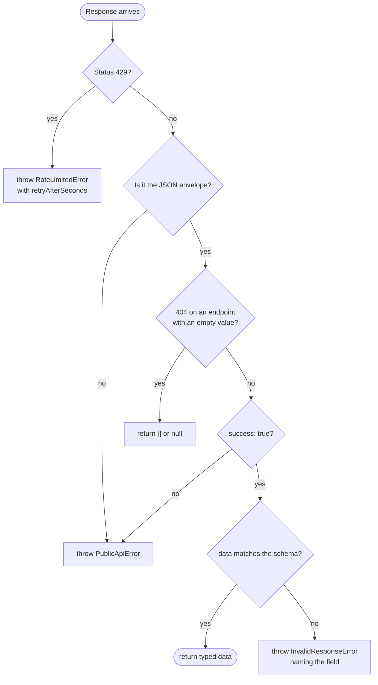
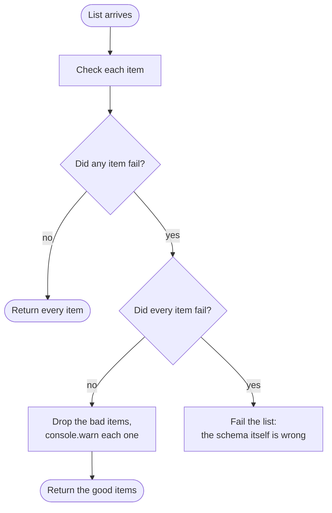
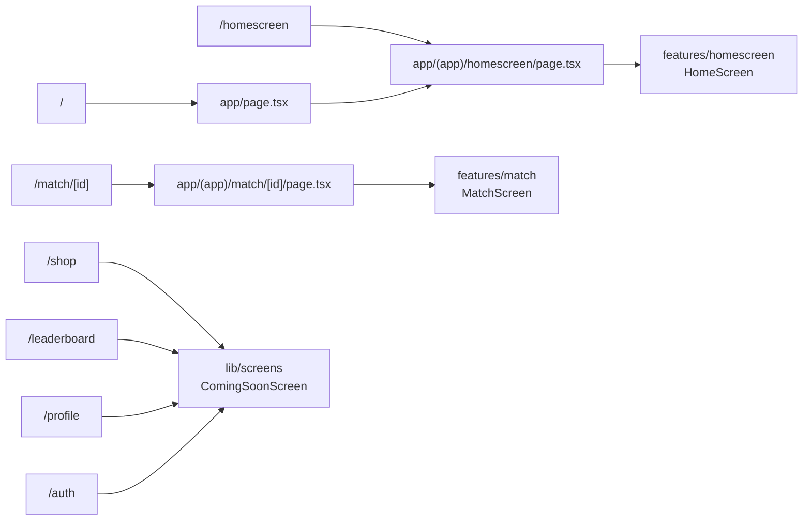
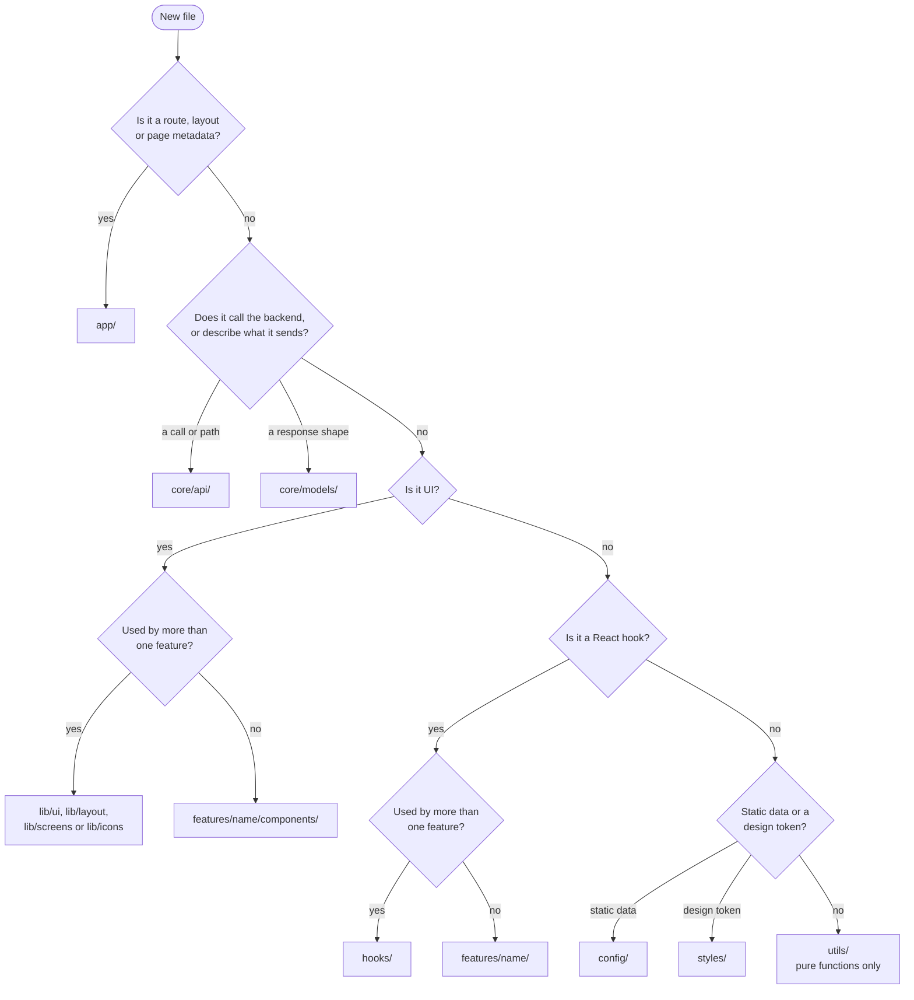
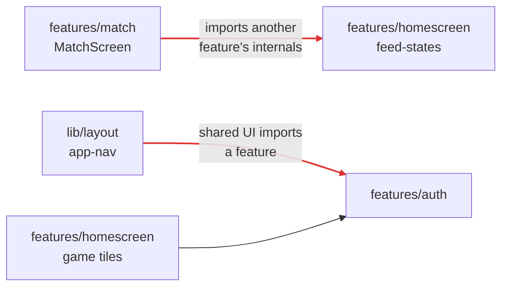
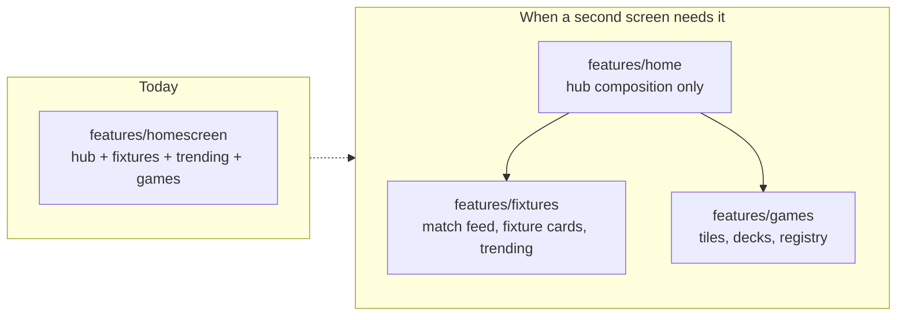

# Folder structure

How the StatOz web app's source is organised, which folder may depend on which,
and how data gets from the backend to the screen. The last section lists what is
still wrong and how to fix it.

- **Stack:** Next.js 16 (App Router, Turbopack, Cache Components), React 19,
  TypeScript, Tailwind 4 plus CSS modules, zod for response validation.
- **Path alias:** `@/*` resolves to `src/*`.

## Contents

1. [Overview](#overview)
2. [The tree](#the-tree)
3. [What each folder is for](#what-each-folder-is-for)
4. [Dependency rules](#dependency-rules)
5. [How data reaches a screen](#how-data-reaches-a-screen)
6. [How responses are validated](#how-responses-are-validated)
7. [Routes and screens](#routes-and-screens)
8. [Where new code goes](#where-new-code-goes)
9. [Conventions](#conventions)
10. [Suggestions](#suggestions)

## Overview

```
src/
├── app/        Routing only: pages, layouts, fonts, global CSS
├── features/   Business features: their screens, components, data hooks, adapters
├── lib/        Shared UI used by more than one feature
├── core/       The API layer and the models of what the API sends
├── hooks/      Hooks used across features
├── config/     Static app data: sports, navigation, image paths
├── styles/     Design tokens, in TypeScript and CSS
└── utils/      Pure helper functions
```

Each top-level folder has one job. If you can't tell which folder a new file
belongs in, see [Where new code goes](#where-new-code-goes).

## The tree

```
src/
├── app/
│   ├── layout.tsx                  # root layout: fonts, metadata, nav shell
│   ├── page.tsx                    # "/" renders the home screen
│   ├── globals.css                 # Tailwind + imports styles/tokens.css
│   ├── fonts/                      # Onest and Orbitron variable fonts
│   ├── auth/page.tsx               # coming soon
│   └── (app)/                      # route group: no URL segment
│       ├── homescreen/page.tsx
│       ├── match/[id]/page.tsx
│       ├── shop/page.tsx           # coming soon
│       ├── leaderboard/page.tsx    # coming soon
│       └── profile/page.tsx        # coming soon
│
├── features/
│   ├── auth/
│   │   └── index.ts                # useAuthSession, useRequireAuth (stub until login exists)
│   ├── homescreen/
│   │   ├── screens/HomeScreen.tsx
│   │   ├── components/
│   │   │   ├── home-hub.tsx  sport-hub-tabs.tsx  sport-icon.tsx  feed-states.tsx
│   │   │   ├── matches/            # fixture cards, match feed, trending feed, team badge
│   │   │   └── games/              # game tiles, decks, scenes, coming-soon dialog
│   │   ├── queries.ts              # data hooks: useTrendingMatches, useDayFixtures…
│   │   ├── adapters.ts             # API models → hub view models
│   │   ├── game-registry.ts        # presentation for each mini-game
│   │   └── types.ts                # the hub's view models
│   └── match/
│       ├── screens/MatchScreen.tsx
│       ├── components/             # scoreboard, stats views, shot maps, pitch, player sheet
│       ├── queries.ts              # data hooks: useMatchStats, useFixtureDays
│       ├── adapters/               # API models → match-page view models, one file per sport
│       ├── match-day.ts            # which day's list a match is on
│       └── types/                  # the match page's view models
│
├── lib/
│   ├── ui/                         # badge, tabs, chips, hud-panel, charts, progress…
│   ├── layout/                     # app-nav, app-top-bar, nav-rail
│   ├── screens/coming-soon.tsx     # shared placeholder screen
│   └── icons/                      # icon base, material icons, registry, brand
│
├── core/
│   ├── api/
│   │   ├── client.ts               # publicGet: fetch, envelope, errors, validation
│   │   ├── endpoints.ts            # ENDPOINTS: every path, in one place
│   │   ├── public-api.ts           # every call, each with its response schema
│   │   ├── resources.ts            # each call paired with its cache key
│   │   └── index.ts                # public surface: errors, calls, resources
│   ├── models/
│   │   ├── game-type.ts            # GameType, MatchGameType, StatsGameType
│   │   ├── team.ts  tournament.ts  game.ts  match.ts
│   │   ├── prediction.ts  event.ts  future.ts  quiz.ts  trending.ts
│   │   ├── list-of.ts              # list schema that drops and reports bad items
│   │   └── stats/                  # MatchStats, RaceStats + one summary type per sport
│   ├── env.ts                      # API_BASE_URL
│   └── index.ts
│
├── hooks/
│   ├── useResource.ts              # in-memory store for data the browser loads
│   └── useTodayInIST.ts
│
├── config/
│   ├── sports.ts                   # sports, their labels and order
│   ├── navigation.ts               # primary nav destinations
│   └── images.ts                   # IMAGES: every image path under /public
│
├── styles/                         # colors, elevation, gradient, shape, spacing, typography, tokens.css
└── utils/                          # format.ts, ist-date.ts
```

## What each folder is for

| Folder | Holds | Never holds |
|---|---|---|
| `app/` | Routes, layouts, metadata, global CSS. Each `page.tsx` is a few lines that render a screen from `features/` or `lib/screens/` | Business logic, data fetching, components |
| `features/<name>/` | One feature's screens, components, data hooks (`queries.ts`), adapters and view-model types | Code another feature imports from inside it |
| `lib/` | Shared UI: primitives (`ui/`), the app shell (`layout/`), shared full screens (`screens/`), icons | Non-UI code; components only one feature uses |
| `core/api/` | Everything that talks to the backend: HTTP, paths, calls, cache keys | UI; feature-specific shaping of data |
| `core/models/` | What the API sends: a zod schema per entity, with its type inferred from the schema, plus its status enums | View models; anything the UI invents |
| `hooks/` | React hooks shared across features | Hooks only one feature uses |
| `config/` | Static app data that every layer may read | Logic; values that come from the API |
| `styles/` | Design tokens as TypeScript values and as CSS variables (`tokens.css`) | Components |
| `utils/` | Pure functions with no React and no styling: formatters, date helpers | Anything visual, anything with state |

### Inside a feature

Every feature follows the same layout:

| File or folder | Role |
|---|---|
| `screens/` | What a route renders. The entry point for `app/` |
| `components/` | UI used only by this feature |
| `queries.ts` | Hooks that ask `core/api` for data, e.g. `useTrendingMatches()` |
| `adapters` | Pure functions that turn API models (`core/models`) into this feature's view models |
| `types` | The feature's view models, the shapes its components render |

A small feature uses single files (`adapters.ts`, `types.ts`). A larger one uses
folders (`adapters/`, `types/`). The `match` feature splits its adapters by
sport.

## Dependency rules

Imports point one way, from the top of this chart down. A folder may import
from any folder below it, and never from one above.



The rules that matter most:

- **Shared code never imports from `features/`.** That includes `lib/`, `core/`,
  `hooks/`, `config/`, `styles/` and `utils/`.
- **A feature never imports another feature's internals.** Anything two features
  need moves down into `lib/` or `core/`.
- **Inside `core/`, `api/` depends on `models/`, never the other way round.**
- **Only `core/api/public-api.ts` calls `publicGet`.** The barrel
  (`core/api/index.ts`) doesn't export `publicGet` or `ENDPOINTS`, so screens
  can only reach the backend through `resources`.

### Inside `core/api`



| File | Knows | Doesn't know |
|---|---|---|
| `client.ts` | HTTP, the `{ statusCode, data, message, success }` envelope, 404 and 429 handling, error classes | Any path |
| `endpoints.ts` | Every path, as strings or functions | How to call them |
| `public-api.ts` | Which path returns which model, checked by which schema | Caching |
| `resources.ts` | The cache key each call is stored under | Screens |

## How data reaches a screen

All data is fetched in the browser. A screen asks for it through a hook, the
hook reads from an in-memory store, and the store loads from the API only when
it has nothing fresh.



What this gives you:

- **Each key loads once.** Two components that ask for the same data share one
  request, because they get the same key.
- **The store respects the API's limit.** The public API allows 60 requests a
  minute per IP, so a value is reused for 30 seconds. After a `429`, the store
  waits as long as the server says before trying again.
- **Components never see raw API shapes.** They render view models made by
  their feature's adapters.

## How responses are validated

`publicGet` checks every response against its schema before returning it.
Lists are tolerant of a single bad item, so one record the app can't read
doesn't blank a whole screen.



Inside a list schema (`listOf` in `core/models/list-of.ts`):



- **Stats summaries are checked only for being an object.** Their types already
  let any field be null at any depth, so the screens guard every read anyway.
- **A model's type comes from its schema** (`z.infer`), so the two can't drift
  apart.

## Routes and screens



The root `layout.tsx` wraps every route with the navigation shell from
`lib/layout`: a side rail on large screens and a bottom bar on small ones.

## Where new code goes



Two rules of thumb:

- **Start inside the feature, and promote it later.** Code moves to `lib/` or
  `core/` only once a second feature needs it.
- **Adding an endpoint touches four files, in this order:** the schema in
  `core/models/`, the path in `endpoints.ts`, the call in `public-api.ts`, and
  the key in `resources.ts`. The feature then uses it from its `queries.ts`.

## Conventions

| Topic | Convention |
|---|---|
| File names | kebab-case: `sport-fixture-card.tsx`, `ist-date.ts` |
| Hooks | `useSomething` |
| Styles | A CSS module next to its component (`badge.module.css`); global tokens in `styles/tokens.css` |
| Image paths | Only through `IMAGES` in `config/images.ts`. ESLint rejects a hardcoded `/assets/...` path anywhere else |
| Barrels | One `index.ts` per shared folder (`@/core`, `@/core/models`, `@/core/api`, `@/styles`, `@/utils`, `@/lib/icons`). Inside a folder, import from the specific file to avoid cycles |
| Models | One file per entity in `core/models/`: the schema, the type inferred from it, and its status enums |
| Statuses | Compare against the exact string. Casing differs by entity: `upcoming` for a match, `Upcoming` for a race, `UPCOMING` for a quiz |

## Suggestions

The structure is in good shape: each folder has one job and imports flow one
way. What's left is mostly at feature boundaries.

### Where the rules are broken today

Red arrows are imports that break the [dependency rules](#dependency-rules).



### Recommended changes, most important first

**1. Fix the two boundary breaks**

| Today | Change to |
|---|---|
| `features/match/screens/MatchScreen.tsx` imports `features/homescreen/components/feed-states` | Move `feed-states` to `lib/ui/feed-states.tsx`. Loading, empty and error states aren't specific to one feature |
| `lib/layout/app-nav.tsx` imports `@/features/auth` | Move auth to `core/auth/`. The session is cross-cutting: shared UI and several features all read it |

**2. Remove the duplicated team badge**

`team-badge.tsx` and its CSS module exist in both
`features/homescreen/components/matches/` and `features/match/components/`. They
are identical apart from one import. The `SportTeam` type is also defined twice,
in `features/homescreen/types.ts` and `features/match/types/match.ts`. Keep one
`lib/ui/team-badge.tsx`, with `SportTeam` defined next to it.

**3. Enforce the rules with ESLint**

Conventions drift, and suggestion 1 shows that they already have. Add a
`no-restricted-imports` rule to `eslint.config.mjs` so that:

- `lib/`, `core/`, `hooks/`, `config/`, `styles/` and `utils/` can't import
  `@/features/*`
- one feature can't import another feature's internals (`@/features/<other>/*`)

Give each feature an `index.ts` that lists what other code may use from it.

**4. Split `homescreen` by domain when the next feature arrives**

`homescreen` is named after a screen but holds three domains: the match feed and
fixture cards, the trending feed, and the games. When a games page or the
leaderboard needs that code, other features will start importing from inside
`homescreen`. Split it then, not before:



**5. Make file names consistent**

`HomeScreen.tsx` and `MatchScreen.tsx` are the only PascalCase component files.
Rename them to `home-screen.tsx` and `match-screen.tsx`. Hook files
(`useResource.ts`, `useTodayInIST.ts`) use the common camelCase hook style;
that's fine as long as every hook follows it.

**6. Add tests**

There are no tests yet. Start with Vitest on the pure functions that carry the
most risk:

- the adapters (`features/homescreen/adapters.ts`, `features/match/adapters/`),
  which hold about 1,650 lines of mapping logic
- `listOf` and the model schemas, tested against saved real responses

**7. Plan the API layer for login**

`publicGet` hardcodes the `/public-api` prefix and `credentials: "omit"`. When
authenticated endpoints arrive, keep one shared `request()` function in
`client.ts`, and add a separate file for the authenticated calls:

```
core/api/
├── client.ts        # request(): envelope, errors, validation; publicGet and authGet use it
├── endpoints.ts     # group by domain once it passes ~20 entries
├── public-api.ts
├── user-api.ts      # authenticated calls
└── resources.ts
```

If the app later moves data fetching to the server, `core/api/` moves to
`server/api/` with `import "server-only"`, and `core/models/` stays where it is,
because the server and the browser both use it.

### Summary

| # | Change | Effort | Risk |
|---|---|---|---|
| 1 | Move `feed-states` to `lib/ui`, auth to `core/auth` | Small | Low |
| 2 | One shared `TeamBadge` and `SportTeam` | Small | Low |
| 3 | ESLint boundary rules + a feature `index.ts` each | Small | None |
| 4 | Split `homescreen` into `home`, `fixtures`, `games` | Large | Medium |
| 5 | kebab-case screen files | Small | None |
| 6 | Vitest + adapter and schema tests | Medium | None |
| 7 | Shared `request()` for authenticated APIs | Medium | Low |

Do 1–3 and 5 together; they're mechanical and remove every boundary problem
above. Do 4 when the next feature starts, 7 when login work starts, and 6
whenever you want a safety net for the adapters.
